This file is a merged representation of the entire codebase, combined into a single document by Repomix.

# File Summary

## Purpose
This file contains a packed representation of the entire repository's contents.
It is designed to be easily consumable by AI systems for analysis, code review,
or other automated processes.

## File Format
The content is organized as follows:
1. This summary section
2. Repository information
3. Directory structure
4. Repository files (if enabled)
5. Multiple file entries, each consisting of:
  a. A header with the file path (## File: path/to/file)
  b. The full contents of the file in a code block

## Usage Guidelines
- This file should be treated as read-only. Any changes should be made to the
  original repository files, not this packed version.
- When processing this file, use the file path to distinguish
  between different files in the repository.
- Be aware that this file may contain sensitive information. Handle it with
  the same level of security as you would the original repository.

## Notes
- Some files may have been excluded based on .gitignore rules and Repomix's configuration
- Binary files are not included in this packed representation. Please refer to the Repository Structure section for a complete list of file paths, including binary files
- Files matching patterns in .gitignore are excluded
- Files matching default ignore patterns are excluded
- Files are sorted by Git change count (files with more changes are at the bottom)

# Directory Structure
```
src/
  core/
    block/
      accessors.rs
      mod.rs
      pow.rs
      transactions.rs
    chain/
      chain.rs
      consensus.rs
      mempool.rs
      mod.rs
      transactions.rs
    cli/
      mod.rs
    network/
      block.rs
      blockchain.rs
      mod.rs
      node.rs
      transaction.rs
    transaction/
      mod.rs
      transactions.rs
      utxo.rs
    mod.rs
  crypto/
    hashing.rs
    keys.rs
    mod.rs
    signatures.rs
  wallet/
    mod.rs
  main.rs
README.md
```

# Files

## File: src/core/chain/mempool.rs
````rust
use super::BlockChain;

impl BlockChain {}
````

## File: src/core/cli/mod.rs
````rust
// simulated module till it is implemented
````

## File: src/core/network/node.rs
````rust
use std::collections::VecDeque;

use crate::{
    core::{block::Block, chain::BlockChain, transaction::Transaction},
    wallet::Wallet,
};
use ed25519_dalek::{PublicKey, SignatureError};
use uuid::Uuid;

#[derive(Debug, Clone)]
pub enum Message {
    Transaction(Transaction),
    Block(Block),
}

#[derive(Debug, Clone)]
pub struct Node {
    pub id: String, // Unique identifier for the node
    pub wallet: Wallet,
    pub chain: BlockChain,
    pub messages: VecDeque<Message>,
    pub peers: Vec<String>, // List of peer node IDs
}

impl Node {
    pub fn new() -> Self {
        Self {
            id: Uuid::new_v4().to_string(),
            wallet: Wallet::new(),
            chain: BlockChain::new(),
            messages: VecDeque::new(),
            peers: Vec::new(),
        }
    }

    /// Adds transaction to the mempool if its valid
    pub fn add_to_mempool(
        &mut self,
        tx: Transaction,
        pk: &PublicKey,
    ) -> Result<Transaction, SignatureError> {
        tx.is_valid(pk)?;
        // Update chain by adding the transaction to the mempool
        self.chain.mempool.push(tx.clone());
        Ok(tx.broadcast())
    }

    /// Mines a new block with the provided transactions
    ///
    /// This function:
    /// 1. Validates all transactions
    /// 2. Adds them to the mempool
    /// 3. Creates a block template with a coinbase transaction
    /// 4. Performs proof-of-work mining
    /// 5. Updates the blockchain with the new block
    ///
    /// # TODO
    /// - Validate UTXOs in the mempool before adding to it (Dynamic vs Canonical UTXO set)
    pub fn mine_block(
        &mut self,
        transactions: Vec<Transaction>,
        pk: &PublicKey,
    ) -> Result<Block, SignatureError> {
        transactions.iter().try_for_each(|tx| tx.is_valid(pk))?;
        transactions
            .into_iter()
            .for_each(|tx| self.chain.mempool.push(tx));

        let mut block = Block::new_template(
            &self.chain.last_hash(),
            &self.wallet.address,
            self.chain.reward,
            self.chain.mempool.clone(),
        );
        block.mine(self.chain.difficulty);
        self.chain.update_from(block.clone());
        Ok(block.broadcast())
    }

    /// Validates a block and adds it to the chain
    pub fn add_block(&mut self, block: Block) -> Result<Block, SignatureError> {
        block.is_valid(self.chain.difficulty)?;
        self.chain.update_from(block.clone());
        Ok(block.broadcast())
    }
}
````

## File: src/core/block/transactions.rs
````rust
use super::Block;

impl Block {}
````

## File: src/core/chain/consensus.rs
````rust
use crate::core::{block::Block, transaction::utxo::UTXO};

use super::BlockChain;

impl BlockChain {
    pub fn mine_funds_for(&mut self, miner: &str) {
        let mut coinbase_block = Block::new_template(&self.last_hash(), miner, self.reward, vec![]);
        coinbase_block.mine(self.difficulty as usize);
        self.create_output_utxos(&coinbase_block);
    }

    pub fn remove_input_utxos(&mut self, block: &Block) {
        for tx in block.transactions.iter() {
            for input in tx.inputs.iter() {
                self.utxos.remove(&(input.tx_id.clone(), input.index));
            }
        }
    }

    pub fn create_output_utxos(&mut self, block: &Block) {
        for tx in block.transactions.iter() {
            for (i, output) in tx.outputs.iter().enumerate() {
                self.utxos.insert(
                    (tx.id.clone(), i),
                    UTXO::new(&tx.id, i, output.amount, &output.recipient),
                );
            }
        }
    }
}
````

## File: src/core/network/block.rs
````rust
use crate::core::block::Block;

/// Methods are simulated while proper network management is added
impl Block {
    #[allow(dead_code)]
    pub fn listen_from_network() {
        todo!()
    }

    #[allow(dead_code)]
    pub fn broadcast(&self) -> Self {
        self.clone()
    }
}
````

## File: src/core/network/blockchain.rs
````rust
use crate::core::chain::BlockChain;

/// Methods are simulated while proper network management is added
impl BlockChain {
    #[allow(dead_code)]
    pub fn retrieve_from_network() -> Self {
        todo!()
    }

    /// function to simulate broadcasting
    #[allow(dead_code)]
    pub fn broadcast(&self) -> Self {
        self.clone()
    }
}
````

## File: src/core/network/transaction.rs
````rust
use crate::core::transaction::Transaction;

// Methods are simulated while proper network management is implemented
impl Transaction {
    #[allow(dead_code)]
    pub fn listen_from_network() -> Vec<Self> {
        todo!()
    }

    /// function to simulate broadcasting
    #[allow(dead_code)]
    pub fn broadcast(&self) -> Self {
        self.clone()
    }
}
````

## File: src/core/mod.rs
````rust
pub mod block;
pub mod chain;
pub mod network;
pub mod transaction;
````

## File: src/crypto/keys.rs
````rust
use ed25519_dalek::Keypair;
use rand::rngs::OsRng;

pub fn generate_key_pair() -> Keypair {
    let mut csprng = OsRng {};
    Keypair::generate(&mut csprng)
}
````

## File: src/crypto/hashing.rs
````rust
use sha3::{Digest, Sha3_256};

use crate::core::block::Block;

/// Computes a SHA3-256 hash of a block
pub fn hash_block(block: &Block) -> String {
    let bytes = bincode::serialize(block).unwrap();
    let hash_value = Sha3_256::digest(&bytes);
    format!("{:016x}", hash_value)
}
````

## File: src/core/block/accessors.rs
````rust
use super::Block;

impl Block {
    pub fn hash(&self) -> Option<String> {
        self.hash.clone()
    }
}
````

## File: src/core/block/pow.rs
````rust
use ed25519_dalek::SignatureError;

use super::Block;
use crate::crypto::hash_block;

impl Block {
    /// Mines this block by finding a nonce that produces a hash with the required difficulty
    ///
    /// The mining process involves incrementing the nonce until the block hash
    /// starts with the specified number of zeros.
    pub fn mine(&mut self, difficulty: usize) {
        let target = "0".repeat(difficulty);
        if self.hash.is_none() {
            self.hash = Some(hash_block(self));
        }
        while !self.hash.as_ref().unwrap().starts_with(&target) {
            self.nonce += 1;
            self.hash = Some(hash_block(self));
        }
    }

    /// Validates that this block meets the proof-of-work requirement
    /// # TODO
    /// * Implement validation of the transactions inside the block
    pub fn is_valid(&self, difficulty: usize) -> Result<(), SignatureError> {
        let target = "0".repeat(difficulty);
        match self.hash.as_ref().unwrap().starts_with(&target) {
            true => Ok(()),
            false => Err(SignatureError::new()),
        }
    }
}
````

## File: src/core/network/mod.rs
````rust
use std::collections::HashMap;

use super::{block::Block, transaction::Transaction};
use node::{Message, Node};
pub mod block;
pub mod blockchain;
pub mod node;
pub mod transaction;

// Simulated module till it is implemented

#[derive(Debug)]
pub struct Network {
    // pub nodes: Vec<Node>,
    pub nodes: HashMap<String, Node>,
}

impl Network {
    pub fn new() -> Self {
        Network {
            // nodes: Vec::new(),
            nodes: HashMap::new(),
        }
    }

    pub fn add_node(&mut self, node: Node) {
        self.nodes.insert(node.id.clone(), node);
    }

    pub fn broadcast(&mut self, node_id: &str, message: Message) {
        todo!()
    }

    pub fn broadcast_transaction(&mut self, tx: Transaction) {
        for node in self.nodes.values_mut() {
            node.messages.push_back(Message::Transaction(tx.clone()));
        }
    }

    pub fn broadcast_block(&mut self, block: Block) {
        for node in &mut self.nodes.values_mut() {
            node.messages.push_back(Message::Block(block.clone()));
        }
    }

    pub fn get(&self, node_id: &str) -> Option<&Node> {
        self.nodes.get(node_id)
    }

    pub fn get_mut(&mut self, node_id: &str) -> Option<&mut Node> {
        self.nodes.get_mut(node_id)
    }
}
````

## File: src/crypto/mod.rs
````rust
pub use hashing::*;
pub use keys::*;
mod hashing;
mod keys;
mod signatures;
````

## File: src/crypto/signatures.rs
````rust

````

## File: README.md
````markdown
# Bitcoin-like Cryptocurrency Implementation in Rust

## Table of Contents

1. [Introduction](#1-introduction)
2. [Project Goals](#2-project-goals)
3. [Architecture and Design Principles](#3-architecture-and-design-principles)
4. [System Architecture](#4-system-architecture)
5. [File Structure Overview](#5-file-structure-overview)
6. [Module Details](#6-module-details)
   - [6.1 Core Module](#61-core-module)
     - [6.1.1 Block Submodule](#611-block-submodule-coreblock)
     - [6.1.2 Chain Submodule](#612-chain-submodule-corechain)
     - [6.1.3 Network Submodule](#613-network-submodule-corenetwork)
     - [6.1.4 Transaction Submodule](#614-transaction-submodule-coretransaction)
     - [6.1.5 CLI and RCP Submodules](#615-cli-and-rcp-submodules)
   - [6.2 Crypto Module](#62-crypto-module)
   - [6.3 Wallet Module](#63-wallet-module)
7. [Transaction Lifecycle](#7-transaction-lifecycle)
8. [Mining Process](#8-mining-process)
9. [Node Interactions](#9-node-interactions)
10. [Security Considerations](#10-security-considerations)
11. [Future Work and Roadmap](#11-future-work-and-roadmap)
12. [Conclusion](#12-conclusion)

## 1. Introduction

This project is a simplified Bitcoin-like cryptocurrency implemented in Rust. It's designed as both an educational and experimental platform, demonstrating core blockchain principles such as decentralized ledger management, transaction validation, Proof of Work (PoW) consensus, and secure cryptographic operations. Though still in early development, it provides a solid foundation for understanding and extending blockchain technology.

## 2. Project Goals

- **Educational Purpose**: Serve as a demonstrative tool to understand how blockchain, PoW, and UTXO based transactions work.
- **Security & Verification**: Leverage cryptographic primitives (hashing, digital signatures, key management) to ensure transaction authenticity and integrity.
- **Modular Design**: Create a clean, modular architecture that can be incrementally expanded to include real networking and a user interface.
- **Future Scalability**: Lay the groundwork for enhancements such as a P2P networking layer, transaction fee mechanisms, and web interface integration.

## 3. Architecture and Design Principles

The implementation follows a modular structure that separates concerns across different domains:

- **Core Blockchain Logic**: Manages blocks, chain integrity, transaction pooling, and consensus rules.
- **Cryptographic Operations**: Handles secure hashing, key generation, and signature verification.
- **Wallet and Transaction Management**: Facilitates user interactions, from signing transactions to updating balances.
- **Network Simulation**: Emulates node-to-node interactions to validate and propagate data across a decentralized system.

Key design principles include:

- **Modularity**: Each functionality (block creation, transaction processing, cryptographic operations) is isolated into its own module.
- **Security**: Robust cryptographic techniques are used to prevent tampering and double-spending.
- **Scalability and Extensibility**: The design supports simulation of multiple nodes and is ready for potential transition to a distributed network.
- **Simplicity and Clarity**: The codebase is structured for clarity, easing the learning curve and facilitating future enhancements.

## 4. System Architecture

### High-Level Component Architecture

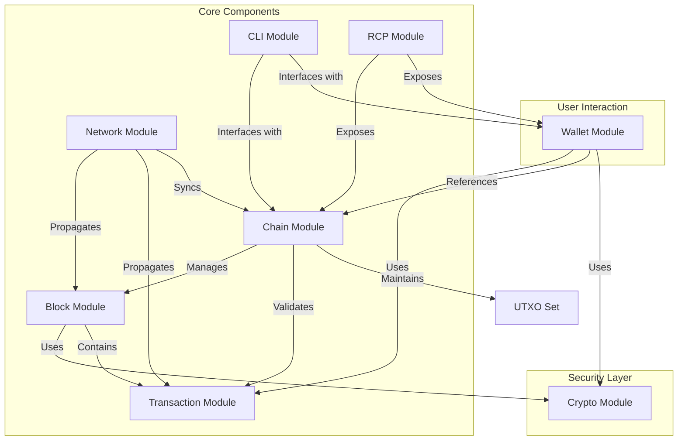

## 5. File Structure Overview

The project is organized as follows:

```
src
├── core
│  ├── block
│  │  ├── accessors.rs         # Functions to retrieve block properties
│  │  ├── mod.rs               # Block module interface and definitions
│  │  ├── pow.rs               # Proof of Work implementation (mining)
│  │  └── transactions.rs      # Block-specific transaction handling
│  ├── chain
│  │  ├── chain.rs             # Blockchain management and ledger state
│  │  ├── consensus.rs         # Consensus rules and conflict resolution
│  │  ├── mempool.rs           # Management of pending transactions
│  │  ├── mod.rs               # Chain module interface and BlockChain definition
│  │  └── transactions.rs      # Transaction integration within the chain
│  ├── cli
│  │  └── mod.rs               # Command-line interface for direct blockchain interaction
│  ├── mod.rs                  # Entry point for core functionalities
│  ├── network
│  │  ├── block.rs             # Block propagation and network validation logic
│  │  ├── blockchain.rs        # Synchronization of blockchain states across nodes
│  │  ├── mod.rs               # Network module interface and Node definition
│  │  └── transaction.rs       # Network transaction broadcasting and validation
│  ├── rcp
│  │  └── mod.rs               # Remote procedure call (API) interfaces
│  └── transaction
│     ├── mod.rs               # Transaction module interface and definitions
│     ├── transactions.rs      # Creation, signing, and validation of transactions
│     └── utxo.rs              # Unspent Transaction Output (UTXO) management
├── crypto
│  ├── hashing.rs              # Cryptographic hashing functions (SHA3-256)
│  ├── keys.rs                 # Key generation and key pair management
│  ├── mod.rs                  # Crypto module entry point
│  └── signatures.rs           # Digital signature creation and verification routines
├── main.rs                    # Entry point with simulation and testing
└── wallet
   ├── mod.rs                  # Wallet interface; handles key management
   └── transactions.rs         # Wallet-specific transaction construction
```

## 6. Module Details

### 6.1 Core Module

The `core` module is the heart of the blockchain logic, encompassing several submodules:

### 6.1.1 Block Submodule (`core/block`)

- **Responsibilities**:
  - Construct blocks containing multiple transactions.
  - Mine blocks by solving the PoW challenge defined in `pow.rs`.
  - Provide accessor functions for querying block data.
- **Key Features**:
  - **Proof of Work (PoW)**: Implemented in `pow.rs`, it ensures that new blocks satisfy a predefined difficulty by finding a nonce that produces a hash with required leading zeros.
  - **Block Structure**: Contains ID, previous hash, timestamp, nonce, transactions list, and own hash.
  - **Block Creation**: `new_template` method creates a block ready for mining, including a coinbase transaction to reward miners.

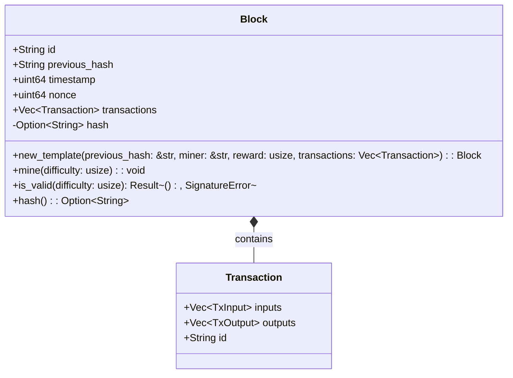

### 6.1.2 Chain Submodule (`core/chain`)

- **Responsibilities**:
  - Manage the blockchain ledger, ensuring proper block order and integrity.
  - Maintain the UTXO set to track unspent transaction outputs.
  - Handle transaction validation and inclusion in blocks.
- **Key Components**:
  - **BlockChain Structure**: Manages blocks, mempool, UTXOs, difficulty, and reward.
  - **UTXO Management**: Methods for adding and removing UTXOs when processing blocks.
  - **Transaction Processing**: `include_transaction` method validates and adds transactions to the mempool.
  - **Block Processing**: `update_from` method adds a block to the chain and updates the UTXO set accordingly.

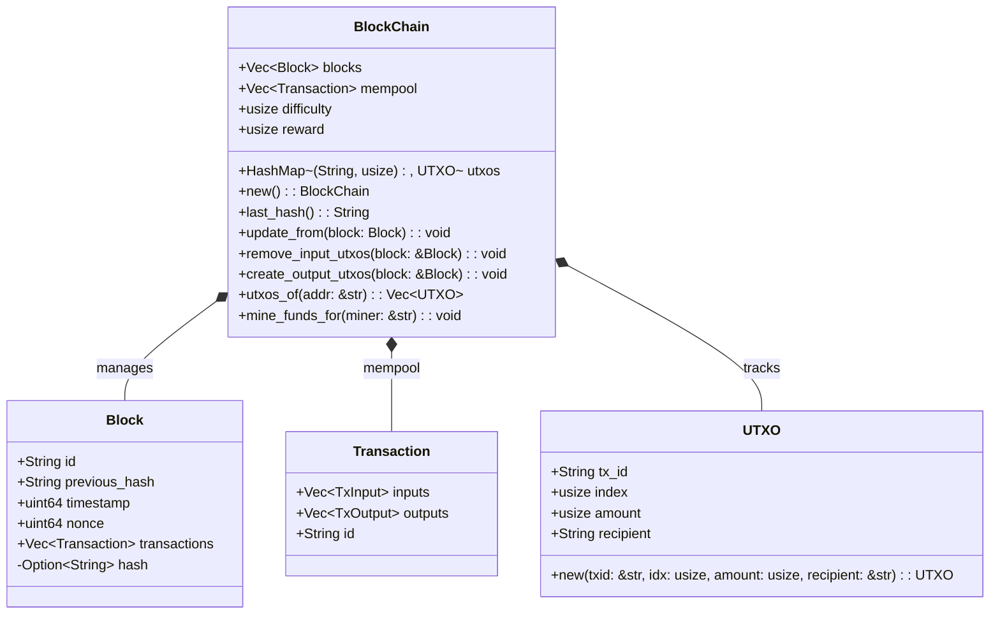

### 6.1.3 Network Submodule (`core/network`)

- **Responsibilities**:
  - Simulate decentralized network behavior for testing and development.
  - Define Node structure that manages blockchain operations in a network context.
- **Key Components**:
  - **Node Implementation**: Contains methods for validating transactions, mining new blocks, and validating blocks.
  - **Simulation Methods**: `broadcast` methods that simulate network propagation of blocks and transactions.

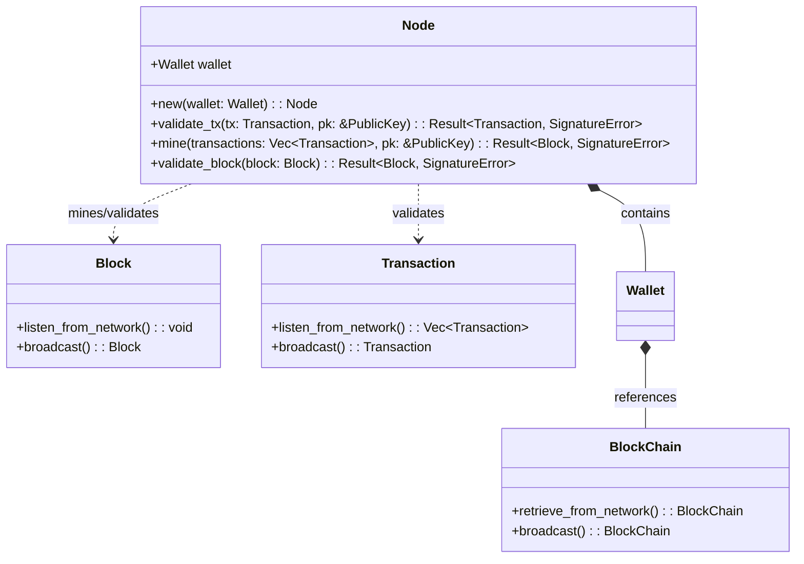

### 6.1.4 Transaction Submodule (`core/transaction`)

- **Responsibilities**:
  - Define the structure and behavior of transactions in the blockchain.
  - Manage transaction creation, validation, and UTXO handling.
- **Key Components**:
  - **Transaction Structure**: Contains ID, inputs, and outputs.
  - **UTXO Implementation**: TxInput, TxOutput, and UTXO structures for the UTXO model.
  - **Transaction Creation**: Methods for creating both regular and coinbase transactions.
  - **Validation**: `is_valid` method to verify transaction signatures.

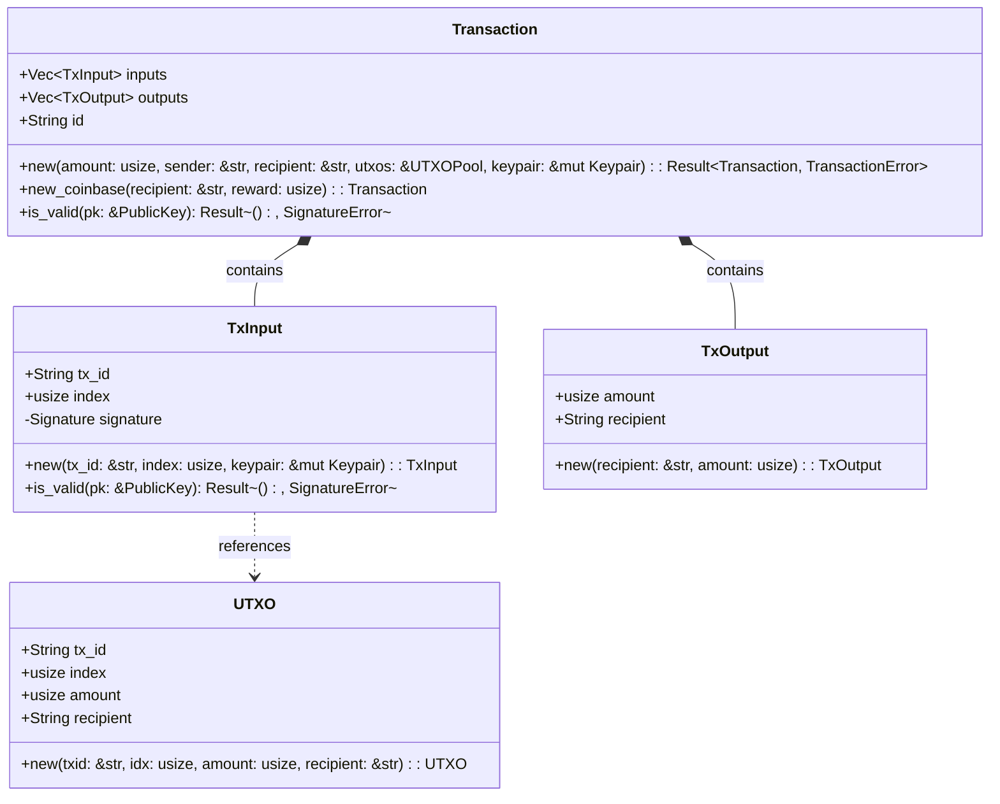

### 6.1.5 CLI and RCP Submodules

- **CLI**: Currently a placeholder module for future command-line interface implementation.
- **RCP**: Placeholder for future remote procedure call interfaces.

### 6.2 Crypto Module

The `crypto` module provides cryptographic functionality:

- **Hashing**: Implements SHA3-256 hashing for blocks and transactions.
- **Key Management**: Generates ed25519 key pairs for wallet creation.
- **Signatures**: Framework for digital signature operations.

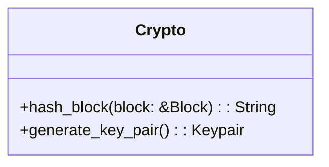

### 6.3 Wallet Module

The `wallet` module enables user interaction with the blockchain:

- **Wallet Structure**: Contains blockchain reference, address (public key representation), and keypair.
- **Transaction Creation**: `transfer` method creates and signs new transactions.
- **Initialization**: `new` method creates a wallet with a fresh keypair.

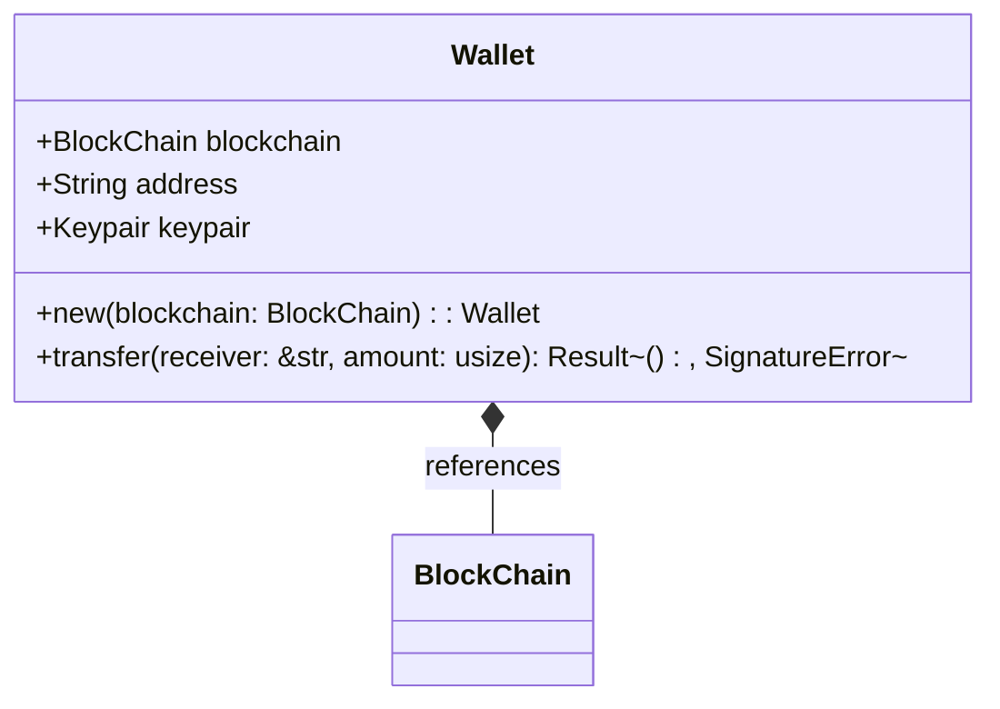

## 7. Transaction Lifecycle

The journey of a transaction through the system:

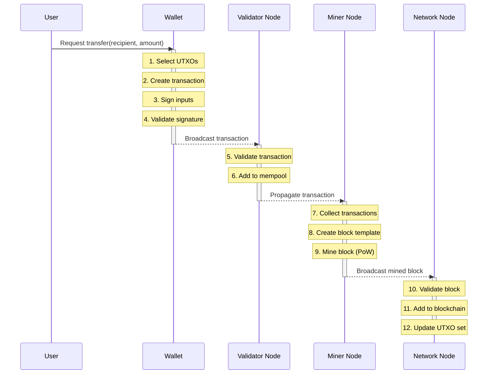

## 8. Mining Process

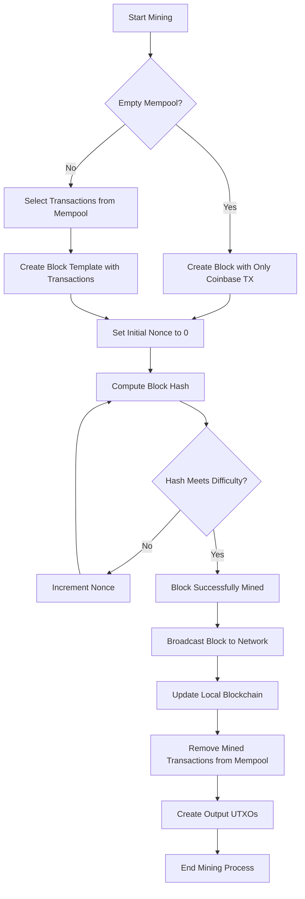

## 9. Node Interactions

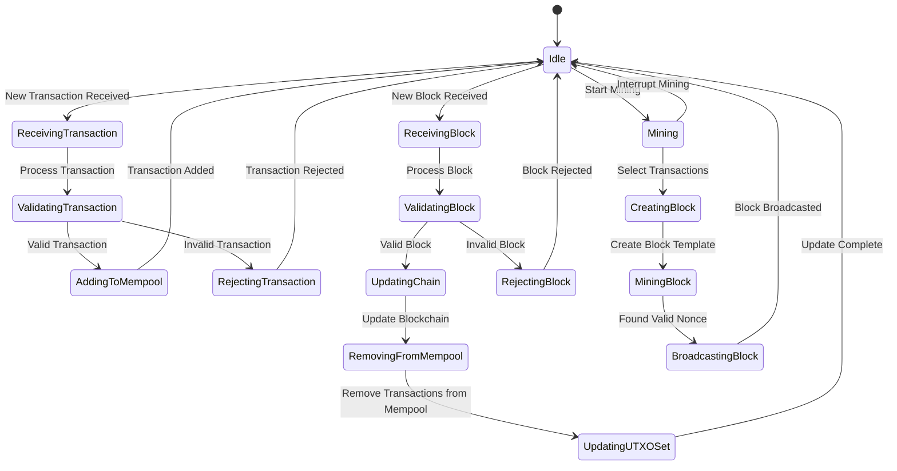

## 10. Security Considerations

Security measures in the implementation:

- **Digital Signatures**: Ed25519 signatures ensure transaction authenticity.
- **Proof of Work**: Mining difficulty prevents easy chain manipulation.
- **UTXO Validation**: Prevents double-spending by tracking spent outputs.
- **Transaction Verification**: Multiple validation points ensure transaction integrity.

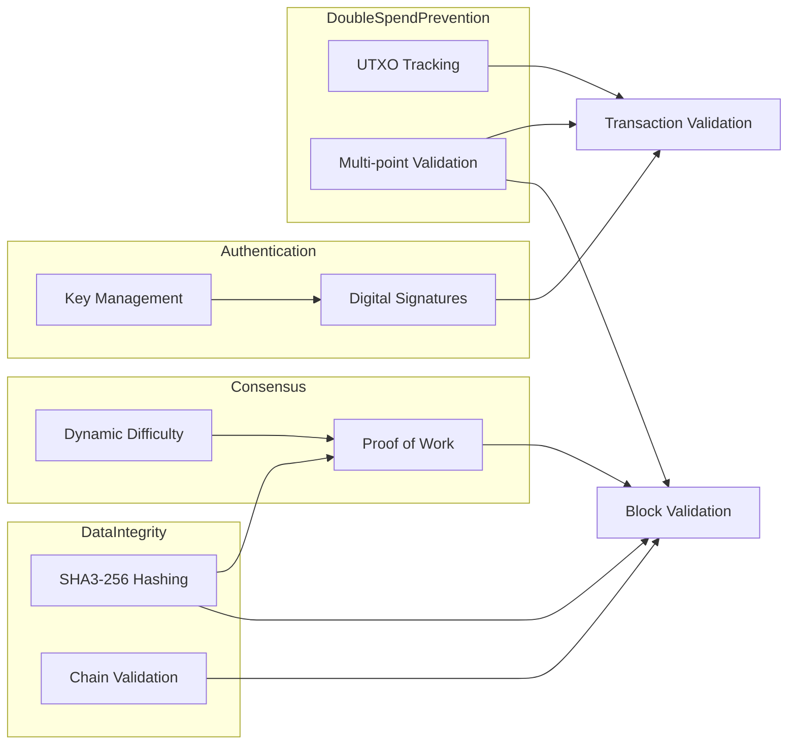

## 11. Future Work and Roadmap

Planned enhancements:

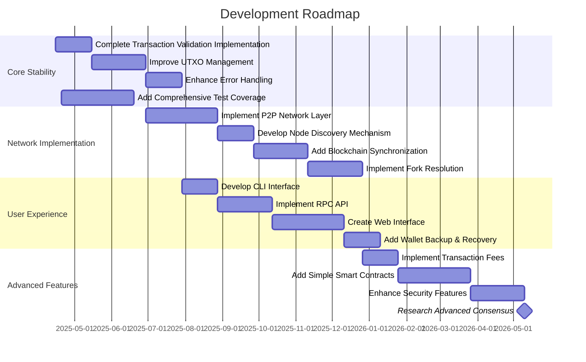

## 12. Conclusion

This Rust cryptocurrency implementation provides a solid foundation for understanding blockchain technology through a hands-on approach. The modular architecture allows for incremental improvements and learning. While primarily educational in nature, the project demonstrates the core principles that underpin real-world cryptocurrencies: secure transactions, consensus through proof-of-work, and a transparent, immutable ledger.

As development continues, the focus will be on enhancing security, networking capabilities, and usability, while maintaining the educational value of the codebase.

---
````

## File: src/core/chain/chain.rs
````rust
use super::BlockChain;
use crate::core::block::Block;

impl BlockChain {
    /// Returns the hash of the last block in the chain
    ///
    /// This is used as the previous_hash when creating a new block.
    pub fn last_hash(&self) -> String {
        self.blocks.last().unwrap().hash().unwrap()
    }

    /// Updates the blockchain with a new block and manages the UTXO pool
    pub fn update_from(&mut self, block: Block) {
        self.remove_input_utxos(&block);
        self.create_output_utxos(&block);
        self.mempool.retain(|tx| !block.transactions.contains(tx));
        self.blocks.push(block);
    }
}
````

## File: src/core/transaction/transactions.rs
````rust
use ed25519_dalek::{PublicKey, SignatureError};

use super::Transaction;

impl Transaction {
    pub fn is_valid(&self, pk: &PublicKey) -> Result<(), SignatureError> {
        self.inputs
            .iter()
            .try_for_each(|txinput| txinput.is_valid(&pk))
    }
}
````

## File: src/core/chain/mod.rs
````rust
use super::transaction::utxo::UTXO;
use crate::core::{block::Block, transaction::Transaction};
use std::collections::HashMap;

mod chain;
mod consensus;
pub mod mempool;
mod transactions;

// TODO! Add coinbase_maturity config (amont of blocks needed to resolve a branch)
#[derive(Debug, Clone)]
pub struct BlockChain {
    pub blocks: Vec<Block>,
    pub mempool: Vec<Transaction>,
    pub utxos: UTXOSet,
    pub difficulty: usize,
    pub reward: usize,
}

/// It is needed to solve the double spending problem inside transactions in the same block.
///
/// the current solution is to have a Canonical and a Dynamic UTXO set
/// - the dynamic is the one to make validations before adding a transaction to a block
/// - the canonical is the one to make validations to transactions in a block in the blockchain
type UTXOSet = HashMap<(String, usize), UTXO>; // (tx_id, idx) -> UTXO

impl BlockChain {
    pub fn new() -> BlockChain {
        let reward = 50 * 1_000_000; // 50 coins
        let mut genesis_block = Block::new_template("", "", reward, vec![]);
        genesis_block.mine(3);
        BlockChain {
            blocks: vec![genesis_block],
            difficulty: 3,
            mempool: vec![],
            utxos: HashMap::new(),
            reward,
        }
    }
}
````

## File: src/core/transaction/utxo.rs
````rust
use ed25519_dalek::{ed25519::signature::SignerMut, Keypair, PublicKey, Signature, SignatureError};
use serde::{Deserialize, Serialize};

/// Transaction input that references an existing UTXO to be spent
///
/// Used to prove ownership of an existing UTXO by including a signature
/// created with the owner's private key.
#[derive(Debug, Clone, Serialize, Deserialize, PartialEq)]
pub struct TxInput {
    pub tx_id: String,
    pub index: usize,
    #[serde(skip_serializing)]
    signature: Signature,
}

/// Transaction output that defines a new UTXO to be created
///
/// Specifies an amount and recipient for a new unspent transaction output.
#[derive(Debug, Clone, Serialize, Deserialize, PartialEq)]
pub struct TxOutput {
    pub amount: usize,
    pub recipient: String,
}

/// Unspent Transaction Output (UTXO) representing a discrete amount of currency owned by someone
///
/// UTXOs are stored in the UTXO pool and are consumed as inputs in new transactions.
/// The UTXO model is fundamental to how transactions work in this blockchain.
#[derive(Debug, Clone, Serialize, Deserialize, PartialEq)]
pub struct UTXO {
    pub tx_id: String,
    pub index: usize,
    pub amount: usize, // satoshis: (1 / 1000000) of a coin
    pub recipient: String,
}

impl TxInput {
    /// Creates a new transaction input by signing the reference to a UTXO
    pub fn new(tx_id: &str, index: usize, keypair: &mut Keypair) -> Self {
        let serialized_data = format!("{}:{}", tx_id, index).as_bytes().to_vec();

        TxInput {
            tx_id: tx_id.to_string(),
            index,
            signature: keypair.sign(&serialized_data),
        }
    }

    /// Validates that this input was signed by the owner of the public key
    pub fn is_valid(&self, pk: &PublicKey) -> Result<(), SignatureError> {
        let txinput_bytes = format!("{}:{}", self.tx_id, self.index).as_bytes().to_vec();
        pk.verify_strict(&txinput_bytes, &self.signature)
    }
}

impl TxOutput {
    pub fn new(recipient: &str, amount: usize) -> Self {
        TxOutput {
            recipient: recipient.to_string(),
            amount,
        }
    }
}

impl UTXO {
    pub fn new(txid: &str, idx: usize, amount: usize, recipient: &str) -> Self {
        UTXO {
            tx_id: txid.to_string(),
            index: idx,
            amount,
            recipient: recipient.to_string(),
        }
    }
}
````

## File: src/core/block/mod.rs
````rust
use chrono::Utc;
use uuid::Uuid;

use super::transaction::Transaction;
pub mod accessors;
pub mod pow;
pub mod transactions;

/// TODO: Change Block.hash from Option<String> to String
/// - Remove Option wrapper since hash should always be present after creation
/// - Update serialization to include hash field
#[derive(Debug, Clone, serde::Serialize, serde::Deserialize)]
pub struct Block {
    id: String,
    previous_hash: String,
    timestamp: u64,
    nonce: u64,
    pub transactions: Vec<Transaction>,
    #[serde(skip_serializing)]
    hash: Option<String>,
}

impl Block {
    /// Creates a new block template ready for mining
    ///
    /// Includes a coinbase transaction that rewards the miner.
    pub fn new_template(
        previous_hash: &str,
        miner: &str,
        reward: usize,
        mut transactions: Vec<Transaction>,
    ) -> Self {
        transactions.push(Transaction::new_coinbase(miner, reward));
        Block {
            id: Uuid::new_v4().to_string(),
            previous_hash: String::from(previous_hash),
            timestamp: Utc::now().timestamp() as u64,
            nonce: 0,
            transactions,
            hash: None,
        }
    }
}
````

## File: src/core/chain/transactions.rs
````rust
use crate::core::transaction::utxo::UTXO;

use super::BlockChain;

impl BlockChain {
    // pub fn include_transaction(
    //     &mut self,
    //     tx: Transaction,
    //     pk: &PublicKey,
    // ) -> Result<(), SignatureError> {
    //     // TODO: Implement comprehensive UTXO validation
    //     // - Verify that transaction inputs reference existing UTXOs
    //     // - Check that total input amount >= total output amount
    //     // - Add unit tests for edge cases (zero inputs, very large amounts)
    //     tx.is_valid(pk)?;
    //     self.mempool.push(tx);

    //     if self.mempool.len() == MAX_TRANSACTIONS {
    //         return Ok(());
    //     }

    //     let transactions = self.mempool.drain(..).collect();

    //     let mut new_block =
    //         Block::new_template(&self.last_hash(), "miner", self.reward, transactions);
    //     new_block.mine(self.difficulty);

    //     self.remove_input_utxos(&new_block);
    //     self.create_output_utxos(&new_block);
    //     self.blocks.push(new_block);
    //     Ok(())
    // }
    //
    pub fn utxos_of(&self, addr: &str) -> Vec<UTXO> {
        let mut utxos = vec![];
        for utxo in self.utxos.values() {
            if utxo.recipient == addr {
                utxos.push(utxo.clone())
            }
        }
        utxos
    }
}
````

## File: src/core/transaction/mod.rs
````rust
use ed25519_dalek::Keypair;
use serde::{Deserialize, Serialize};
use std::collections::HashMap;
use utxo::{TxInput, TxOutput, UTXO};
use uuid::Uuid;

pub mod transactions;
pub mod utxo;

/// Represents a blockchain transaction that transfers value between addresses
///
/// A transaction consists of inputs (consumed UTXOs) and outputs (created UTXOs).
/// Each transaction has a unique ID computed from its contents.
#[derive(Debug, Clone, Serialize, Deserialize, PartialEq)]
pub struct Transaction {
    pub inputs: Vec<TxInput>,
    pub outputs: Vec<TxOutput>,
    pub id: String,
}

/// Possible errors that can occur during transaction processing
#[derive(Debug, Clone, Serialize, Deserialize, PartialEq)]
pub enum TransactionError {
    InsufficientBalance,
    InvalidSignature,
}

/// A pool of unspent transaction outputs indexed by transaction ID and output index
type UTXOPool = HashMap<(String, usize), UTXO>;

impl Transaction {
    /// Creates a new transaction transferring funds from sender to recipient
    pub fn new(
        amount: usize,
        sender: &str,
        recipient: &str,
        utxos: &UTXOPool,
        keypair: &mut Keypair,
    ) -> Result<Self, ()> {
        // Find available UTXOs belonging to the sender
        // Sort by amount to minimize the number of inputs needed
        let mut available_utxos: Vec<_> = utxos
            .iter()
            .filter(|(_, utxo)| utxo.recipient == sender)
            .collect();
        available_utxos.sort_by_key(|(_, utxo)| utxo.amount);

        // Collect enough inputs to cover the amount
        let mut acc_amount = 0;
        let mut inputs = vec![];
        for ((txid, idx), utxo) in available_utxos {
            if acc_amount >= amount {
                break;
            }
            acc_amount += utxo.amount;
            inputs.push(TxInput::new(txid, *idx, keypair));
        }

        // Return error if insufficient funds
        if acc_amount < amount {
            return Err(());
        }

        // Create outputs: one for the recipient and one for change (if any)
        let mut outputs = vec![TxOutput::new(recipient, amount)];
        if acc_amount > amount {
            outputs.push(TxOutput::new(sender, acc_amount - amount))
        }

        let tx = Self {
            id: Uuid::new_v4().to_string(),
            inputs,
            outputs,
        };
        Ok(tx)
    }

    /// Creates a new coinbase transaction that generates new coins for a miner
    ///
    /// Coinbase transactions have no inputs and create new currency.
    pub fn new_coinbase(recipient: &str, reward: usize) -> Self {
        Self {
            id: Uuid::new_v4().to_string(),
            inputs: vec![],
            outputs: vec![TxOutput::new(recipient, reward)],
        }
    }
}
````

## File: src/wallet/mod.rs
````rust
use crate::crypto::generate_key_pair;
use ed25519_dalek::Keypair;

#[derive(Debug)]
pub struct Wallet {
    pub address: String,
    pub keypair: Keypair,
}

impl Clone for Wallet {
    fn clone(&self) -> Self {
        let bytes = self.keypair.to_bytes();
        let keypair = Keypair::from_bytes(&bytes).unwrap();
        Self {
            address: self.address.clone(),
            keypair,
        }
    }
}

impl Wallet {
    pub fn new() -> Self {
        let keypair = generate_key_pair();
        // TODO! Add the hashed pk as an address
        Wallet {
            address: format!("{:?}", keypair.public),
            keypair,
        }
    }
}
````

## File: src/main.rs
````rust
use core::{
    network::{
        node::{Message, Node},
        Network,
    },
    transaction::Transaction,
};
use ed25519_dalek::SignatureError;

mod core;
mod crypto;
mod wallet;

/// # Description
/// Bitcoin-like cryptocurrency implementation
///
/// This project implements a simplified cryptocurrency with the following features:
/// - Proof of Work (PoW) consensus mechanism
/// - Unspent Transaction Output (UTXO) model for balance and funds handling
///
/// The main function simulates different nodes working in the network:
/// - Node listening is represented by taking information as input
/// - Node broadcasting is represented by the output of broadcast methods
///
/// This simulation approach is used for testing purposes while proper
/// network management is being developed.
///
/// # Implementation Notes
/// - Validation is intentionally redundant to simulate multiple validations
///   that would occur in a real network
///
/// # TODO
/// - Simulate fraudulent transactions and nodes
/// - Implement Canonical and Dynamic UTXO set
/// - Implement a fork handling system
/// - Improve error handling
/// - Improve testing
/// - Define clearer interfaces
fn main() {
    let mut network = Network::new();

    // // Create nodes
    // let mut sender_node = Node::new();
    // let mut receiver_node = Node::new();
    // let mut miner_node = Node::new();

    // // Add nodes to the network
    // network.add_node(sender_node.clone());
    // network.add_node(receiver_node.clone());
    // network.add_node(miner_node.clone());

    // add 3 nodes to the network
    for _ in 0..3 {
        network.add_node(Node::new());
    }
    let mut sender_node = &network.nodes[0];
    let receiver_node = &network.nodes[1];
    let miner_node = &network.nodes[2];

    // mine for the sender
    sender_node
        .chain
        .mine_funds_for(&sender_node.wallet.address);
    // sender_node
    //     .chain
    //     .mine_funds_for(&sender_node.wallet.address);

    // Create and broadcast transactions
    let transaction_amounts = [3 * 1_000_000, 5 * 1_000_000, 10 * 1_000_000];
    for amount in transaction_amounts.iter() {
        let tx = transfer(&mut sender_node, &receiver_node.wallet.address, *amount).unwrap();
        network.broadcast_transaction(tx);
    }

    // Process transactions from the network
    for node in network.nodes.iter_mut() {
        while let Some(message) = node.messages.pop_front() {
            if let Message::Transaction(tx) = message {
                node.add_to_mempool(tx, &sender_node.wallet.keypair.public)
                    .unwrap();
            }
        }
    }

    // Miner mines a new block
    let block = miner_node
        .mine_block(
            miner_node.chain.mempool.clone(),
            &sender_node.wallet.keypair.public,
        )
        .unwrap();
    network.broadcast_block(block);

    // Process the new block from the network
    for node in network.nodes.iter_mut() {
        while let Some(message) = node.messages.pop_front() {
            if let Message::Block(block) = message {
                node.add_block(block).unwrap();
            }
        }
    }

    // Print UTXOs for each node
    for node in network.nodes.iter() {
        println!(
            "UTXOS for node:
        {:#?}
        ",
            // node.id,
            node.chain.utxos_of(&node.wallet.address)
        );
    }
}

/// Creates and signs a transaction from a wallet to a receiver
///
/// This function creates a new transaction, validates it with the sender's
/// public key, and returns a broadcast-ready transaction.
fn transfer(
    sender: &mut Node,
    receiver_addr: &str,
    amount: usize,
) -> Result<Transaction, SignatureError> {
    let tx = Transaction::new(
        amount,
        &sender.wallet.address,
        receiver_addr,
        &mut sender.chain.utxos,
        &mut sender.wallet.keypair,
    )
    .unwrap();
    tx.is_valid(&sender.wallet.keypair.public)?;
    Ok(tx.broadcast())
}
````
